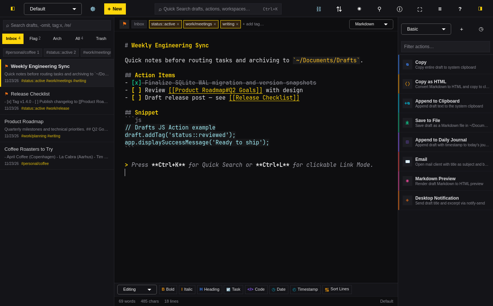

# Drafts for Omarchy Linux



**Where text starts** — a native C++ / Qt 6 Quick text-capture, organization, and JavaScript automation app built for [Omarchy Linux](https://omarchy.org), modeled on Agile Tortoise's Drafts for macOS and iOS.

Drafts follows your active Omarchy theme (`colors.toml`) and Hyprland window rounding live, speaks Omarchy's language settings live (including right-to-left mirroring), and ships both a keyboard-driven GUI and a headless CLI for scripts and agents.

## Capabilities

- **Instant Capture & Quick Capture Window**: Launch directly into the editor, press `Ctrl+N` for a fresh draft, or bind `drafts capture` in Hyprland for a floating global capture window (`Ctrl+Enter` to save).
- **Inbox, Flagged, Archive, All & Trash**: Color-coded flags (orange, red, yellow, green, blue, purple), one-click archiving, trash recovery, and empty trash.
- **Nested & Scoped Tags**: Organize with hierarchical tags (`work/projects/alpha`) and exclusive scoped tags (`status::active` automatically replaces `status::todo`).
- **Workspaces**: Save contextual views combining tag filters (AND/OR + `-omit`), search queries, sort order, default folder, and linked Action Group & Action Bar Group.
- **Live Syntax Highlighting**: Markdown, GitHub Flavored Markdown, TaskPaper, JavaScript, JSON, HTML, and Plain Text — dynamically styled to match your Omarchy accent.
- **Wiki-Links (`[[Title]]`), Outline & Backlinks**: Jump between drafts (`[[Title]]`, `[[Title#Heading]]`, `[[w:Workspace]]`, `[[s:Query]]`, `[[google:Query]]`), auto-create missing targets, and browse automatic Backlinks and heading outlines in the Inspector (`Ctrl+I`).
- **Writing Modes**:
  - **Focus Mode** (`F11` / `Ctrl+Shift+F`) for distraction-free writing
  - **Link Mode** (`Ctrl+L`) for clickable URLs, emails, `[[wiki-links]]`, and live `- [ ]` checkboxes
  - **Arrange Mode** (`Ctrl+Shift+A`) to split by lines or paragraphs, reorder, sort, reverse, duplicate, or delete blocks
  - **Markdown / HTML Preview** (`Ctrl+Shift+P`) with Copy HTML, Export HTML, and Open in Browser
  - **Typewriter Scrolling** & full typography customization (font, size, line height, max width)
  - **Find & Replace** (`Ctrl+F` / `Ctrl+H`) with case sensitivity and regex support
- **Version History**: Automatic background snapshots plus manual Save Version (`Ctrl+S`), preview, copy, and one-click restore.
- **Multi-Step Actions, Templates & JavaScript Engine (`QJSEngine`)**:
  - Template tags: `[[draft]]`, `[[title]]`, `[[safe_title]]`, `[[body]]`, `[[selection]]`, `[[line|n..m]]`, `[[tags]]`, `[[hashtags]]`, `[[clipboard]]`, `[[markdown]]`, `[[date|+1 day|%Y-%m-%d]]`, `[[enc:...]]`
  - Action step types: `script` (JavaScript), `clipboard`, `file` (write/append/prepend), `insert_text`, `shell` (pipes draft to stdin, captures stdout), `url`, `mail`, `html_preview`
  - Drafts-compatible JS API: `draft`, `editor`, `app`, `Draft`, `ShellScript`, `FileManager`, `HTTP`, `context`, `console`
  - After-success rules (`nothing`, `archive`, `trash`), Action Bar, Action Log, and JSON Action import/export
- **Quick Search (`Ctrl+K`)**: Unified fuzzy/query palette across Drafts (`"phrase"`, `-omit`, `tag:`, `is:flagged`, `/regex/`), Actions, and Workspaces.
- **URL Schemes (`drafts://`) & Atomic Backups**: Supports `drafts://create`, `drafts://open`, `drafts://append`, `drafts://prepend`, `drafts://search`, `drafts://workspace`, `drafts://runAction`, plus JSON backup/restore and native xdg-desktop-portal file dialogs.

## Keyboard Shortcuts

| Shortcut | Action |
| --- | --- |
| `Ctrl+N` | New blank draft |
| `Ctrl+K` / `Ctrl+Shift+Space` | Quick Search (drafts, actions, workspaces) |
| `Ctrl+1` / `Ctrl+2` | Toggle Draft List / Action Panel |
| `F11` / `Ctrl+Shift+F` | Toggle Focus Mode |
| `Ctrl+L` | Toggle Link Mode (clickable URLs, wiki-links, tasks) |
| `Ctrl+Shift+A` | Open Arrange Mode (reorder lines or paragraphs) |
| `Ctrl+Shift+P` | Toggle Markdown / HTML Preview |
| `Ctrl+I` | Toggle Inspector (Outline, Backlinks, Versions, Info) |
| `Ctrl+F` / `Ctrl+H` | Find & Replace in current draft |
| `Ctrl+S` | Save manual version snapshot |
| `Ctrl+Shift+L` | Toggle flag on current draft |
| `Ctrl+Shift+T` | Toggle Markdown task checkbox at cursor |
| `Ctrl+Shift+E` | Archive current draft |
| `Ctrl+Up` / `Ctrl+Down` | Previous / Next draft |
| `Ctrl+,` | Editor Settings & Backup |
| `?` / `F1` | Show keyboard shortcuts overlay |
| `Esc` | Close active overlay or unfocus editor |
| `Ctrl+Q` / `Q` | Quit Drafts |

## Headless CLI & Agent Integration

Every CLI command runs offscreen (no display required) and supports `--json`:

```sh
# Capture a new draft (or pipe from stdin)
drafts new --text "# Release Notes\n- Ready to ship" --tag work/release --flag --json
echo "Quick note from terminal" | drafts new --tag inbox --json

# Query and update drafts
drafts list --folder inbox --workspace Writing --json
drafts search '"Release Notes" -archived' --json
drafts get "Release Notes" --json
drafts append "Release Notes" "- [ ] Announce on blog" --json

# Execute any Drafts Action (including JavaScript and Shell steps)
drafts run "Copy as HTML" "Release Notes" --json

# Workspaces, Actions, URL schemes & Backups
drafts workspaces --json
drafts actions --json
drafts open-url "drafts://create?text=Captured&tag=quick" --json
drafts export ~/drafts-backup.json --json

# Install bundled agent skill
drafts skill install
```

### Hyprland Global Quick Capture Binding

Add to `~/.config/hypr/bindings.conf` for instant system-wide capture:

```ini
bindd = SUPER SHIFT, D, Quick Capture Draft, exec, drafts capture
```

## Build, Test & Install

```sh
./bin/build      # Builds build/drafts with qmake6 + make
./bin/test       # Builds and runs the offscreen Qt Test suite
./bin/install    # Builds and installs the Arch package (launcher + icon + drafts:// handler)
```

## License

MIT — see [LICENSE](LICENSE).
